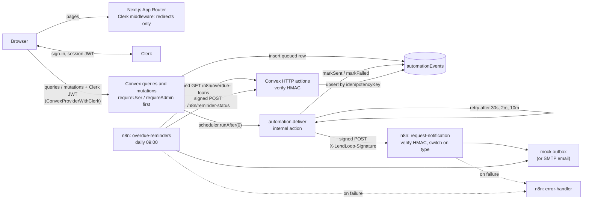

# LendLoop

> Borrow what you need. Lend what you don't.

LendLoop is a neighborhood tool-lending board. Neighbors list tools, request to borrow them for a
date range, approve or decline requests, and mark loans returned. Each loan change sends a
notification, and borrowers get overdue reminders. n8n delivers both and talks to Convex over
HMAC-signed webhooks in both directions. The stack is Next.js 15 (App Router), Clerk, Convex, n8n
(Docker) and Tailwind.

**What each role can do**

| Role | Can do |
|---|---|
| Guest | See the public list of available tools (name and category only), then sign in. |
| Signed-in user | Browse every tool with status, condition, owner name (first name and last initial, e.g. "Ben C.") and Trusted Lender badge; filter by category and search by name. List, edit and delete their own tools. Request someone else's tool for up to 30 days. Cancel their own pending requests. Approve, decline and mark returned on requests for their tools. See every email sent about each request, including failed ones. |
| Admin | Everything a user can do. Also: see all loans, tools (including removed ones), neighbors and automated emails (failed ones show why), resend a failed email, remove any listing, and toggle Trusted Lender. |

Roles are stored only in the Convex `users` table. See [Admin bootstrap](#5-admin-bootstrap).

**Live demo:** https://lendloop-mu.vercel.app, running on Vercel with a Convex production
deployment and the Clerk **development** instance. Emails only go out while n8n is running on
my PC: see [Deployment](#deployment).

---

## Architecture



**What happens when a borrower makes a request**

1. The browser calls `loans.request` with the Clerk JWT attached by `ConvexProviderWithClerk`.
   Convex validates the token against the Clerk issuer.
2. `requireUser(ctx)` runs first. The mutation then checks the tool (missing or removed gives
   `NOT_FOUND`; the caller's own tool gives `FORBIDDEN`) and the dates (R2), and inserts a
   `pending` loan.
3. In the same transaction it inserts one `automationEvents` row (`queued`, key
   `<loanId>:loan.requested`) and schedules `internal.automation.deliver`. The mutation itself
   never calls the network.
4. `deliver` builds the minimal payload, which contains the lender's name and email only. It signs
   the payload with `CONVEX_TO_N8N_SECRET` and POSTs it to `N8N_REQUEST_WEBHOOK_URL`. On a 2xx the
   row becomes `sent`. Otherwise it retries after 30 s, 2 min and 10 min, then becomes `failed`
   with `lastError`.
5. n8n checks the signature against the raw body. It answers 401 if the check fails. Otherwise it
   routes on `type`, writes the message to the mock outbox and answers 200.
6. The borrower's `/my/requests` view is a reactive Convex query, so the email's line in the
   request's Activity ledger turns from SENDING to EMAIL (or FAILED) without a refresh.

Overdue reminders work the other way round. Every day at 09:00, n8n makes a signed `GET` for
overdue loans, sends one reminder per loan and writes each result back with a signed `POST`. The
write-back is keyed `<loanId>:<YYYY-MM-DD>`, so retries and re-runs never add a duplicate.

[docs/ARCHITECTURE.md](docs/ARCHITECTURE.md) covers the modules, the function-by-function access
table, the data model, sequence diagrams and failure modes.

**Design.** The UI follows a library checkout card: paper background (`#F3F4F1`), ink text
(`#15201B`), pine green for actions (`#1F6B4E`) and sun yellow for attention (`#F5C518`).
Headings use Archivo, body text Atkinson Hyperlegible, and dates and statuses IBM Plex Mono, all
self-hosted with `next/font`. Dates read US style ("Nov 8", "Nov 8–10"). Motion is limited to
feedback: a rubber-stamp press when you send, approve, decline, return or resend, a slide-up
borrowing card on phones, and button press scaling. All of it is off under
`prefers-reduced-motion`. The tokens live in `app/globals.css`.

---

## Setup

### Prerequisites

- Node 20+ (developed on Node 22), npm, Git
- Docker Desktop (for n8n via `docker-compose`)
- Free accounts at [Clerk](https://clerk.com) and [Convex](https://convex.dev)
- `cloudflared` (or n8n Cloud) so that Convex, which runs in the cloud, can reach your n8n

```bash
npm install
cp .env.example .env.local
```

### 1. Clerk

1. Create a Clerk application. Email sign-in is enough.
2. Go to **Configure → Integrations → Convex → Activate**. Copy the **Issuer URL** it shows, for
   example `https://<your-app>.clerk.accounts.dev`. That value is `CLERK_JWT_ISSUER_DOMAIN`.
3. **Add email and name to the session token.** With the current Clerk integration, Convex
   receives Clerk's *session* token (`aud = convex`), which carries no email or name by default.
   Without them `ADMIN_EMAILS` can't match anyone and notifications have no recipient. Open
   **Configure → Sessions → Customize session token** and add:
   ```json
   {
     "email": "{{user.primary_email_address}}",
     "name": "{{user.full_name}}",
     "email_verified": "{{user.email_verified}}"
   }
   ```
   Then sign out and back in, so `users.ensure` stores the email (and applies `ADMIN_EMAILS`).
4. Copy the publishable key and secret key into `.env.local` as `NEXT_PUBLIC_CLERK_PUBLISHABLE_KEY`
   and `CLERK_SECRET_KEY`.

The sign-in and sign-up URLs are set in code (`/sign-in`, `/sign-up`), so no Clerk URL env vars
are needed.

### 2. Convex

```bash
npx convex dev            # logs in, creates the dev deployment, writes NEXT_PUBLIC_CONVEX_URL
                          # (and CONVEX_DEPLOYMENT) into .env.local, then watches convex/
```

In a second terminal, set the server-side variables. Generate each secret with
`node -e "console.log(require('crypto').randomBytes(32).toString('hex'))"`:

```bash
npx convex env set CLERK_JWT_ISSUER_DOMAIN <issuer url from Clerk>
npx convex env set ADMIN_EMAILS you@example.com            # comma-separated, optional
npx convex env set CONVEX_TO_N8N_SECRET <random hex>       # Convex signs, n8n verifies
npx convex env set N8N_TO_CONVEX_SECRET <another random hex> # n8n signs, Convex verifies
# N8N_REQUEST_WEBHOOK_URL is set after n8n is running (step 4)
```

### 3. Run the app

```bash
npm run dev               # http://localhost:3000
```

### 4. n8n via docker-compose

Full walkthrough: [n8n/README.md](n8n/README.md).

1. **Tunnel.** Convex cannot reach `localhost:5678`, so give n8n a public URL. Either run the
   bundled cloudflared container, `docker compose --profile tunnel up -d`, and read the
   `https://<random>.trycloudflare.com` URL from `docker compose logs tunnel`. Or, with cloudflared
   installed, run `cloudflared tunnel --url http://localhost:5678`.
2. **`n8n/.env`.** Run `node n8n/scripts/write-env.mjs --webhook-url <tunnel URL>`. It copies both
   shared secrets from `npx convex env list`, derives `CONVEX_SITE_URL` from your deployment, sets
   `WEBHOOK_URL`, and prints names only. Or copy `n8n/.env.example` to `n8n/.env` (git-ignored) and
   fill it in by hand. Optionally set `ALERT_WEBHOOK_URL` to a Slack or Discord webhook.
3. **Start.** Run `docker compose up -d` (again after changing `n8n/.env`, so n8n picks it up), open
   http://localhost:5678 and create the owner account.
   The image is pinned to `n8nio/n8n:2.47.1`.
4. **Import** the three files in `n8n/workflows/`. No credentials need selecting, because all
   secrets come from `$env`.
5. **Error workflow.** In *request-notification* and *overdue-reminders*, open **⋯ → Settings →
   Error workflow** and choose *LendLoop: error handler*. The export can't carry this setting,
   because ids change on import.
6. **Publish** *request-notification* and *overdue-reminders*. In n8n 2.x, Publish replaces the
   old Active toggle.
7. **Point Convex at n8n.** Copy the Webhook node's **production** URL
   (`<WEBHOOK_URL>/webhook/lendloop-request`), then:
   ```bash
   npx convex env set N8N_REQUEST_WEBHOOK_URL <that url>
   ```
   A quick tunnel gets a new URL each time it restarts. When that happens, update `WEBHOOK_URL`,
   restart n8n and repeat this step.

`n8n/scripts/signed-request.mjs` sends signed, forged and stale test requests (see n8n/README.md).

### 5. Admin bootstrap

There are two ways to make someone an admin. Neither goes through a client-callable function.

- **`ADMIN_EMAILS`** (Convex env var, comma-separated). `users.ensure` runs after every sign-in and
  promotes a user whose Clerk email is on the list. It **only promotes, never demotes**, so taking
  an email off the list does not lock out a working admin.
- **`users.setRole`** (internal mutation). Use it to promote or demote from the CLI or the Convex
  dashboard (**Functions → users:setRole → Run**). Find the user id in the dashboard's `users`
  table:
  ```bash
  npx convex run users:setRole '{"userId":"<users id>","role":"admin"}'
  npx convex run users:setRole '{"userId":"<users id>","role":"user"}'
  ```

### 6. Test users and demo data

```bash
node scripts/clerk-test-users.mjs
```

This uses the Clerk Backend API with `CLERK_SECRET_KEY` from `.env.local` (it refuses anything
but an `sk_test_` key, and never prints it). It creates or renames five test users in your Clerk
development instance, with first and last names set:

| User | Email | Role in the demo |
|---|---|---|
| Ben C. | `ben+clerk_test@example.com` | lender in the e2e run |
| Maya R. | `maya+clerk_test@example.com` | borrower in the e2e run |
| Marcus D., Olivia P., Jake T. | `marcus+`, `olivia+`, `jake+clerk_test@example.com` | seed neighbors |

`+clerk_test` addresses are Clerk test users: no real email is sent and the verification code is
`424242`. The script then runs the internal `seed:neighbors`, which puts Marcus, Olivia and Jake
and two tools each on the board (jigsaw, carpet cleaner, ladder, stand mixer, tent, tile
cutter), linked to their Clerk ids. Running it again changes nothing.

The app shows every name as first name and last initial. For that, the Clerk session token must
carry the user's name (step 1).

### 7. Seed an overdue loan (demo)

To see the reminder in the app, make **yourself** the borrower. Sign in once, then copy your
`_id` from the Convex dashboard's `users` table:

```bash
npx convex run seed:overdueLoan '{"borrowerId":"<your users id>"}'
```

This creates an approved loan of Olivia P.'s stand mixer that ended yesterday (UTC), so you can't
be both sides. Then open *overdue-reminders* in n8n and click **Execute workflow**. "Overdue
reminder sent to you" appears in the loan's Activity on your `/my/requests`, under a yellow
"due back" banner. Run the workflow again and nothing is sent, because Convex skips loans already
reminded today.

Without arguments (`npx convex run seed:overdueLoan`) the borrower is Jake T., a seed user. The
reminder then shows only in **Admin → Automated emails**. Pass `toolId` as well to reuse one of
your own tools; its owner becomes the lender. The command can be run repeatedly.

---

## Environment variables

Names only. Values live in `.env.local`, in Convex (`npx convex env set`) or in `n8n/.env`, and
never in the repo.

| Name | Where it's set | Used by | Purpose |
|---|---|---|---|
| `NEXT_PUBLIC_CONVEX_URL` | `.env.local` (written by `npx convex dev`) | Next.js client | Convex deployment URL for `ConvexReactClient`. |
| `NEXT_PUBLIC_CLERK_PUBLISHABLE_KEY` | `.env.local` | Next.js (Clerk) | Clerk frontend key. |
| `CLERK_SECRET_KEY` | `.env.local` | Next.js middleware / server (Clerk) | Clerk backend key. Secret. |
| `CLERK_JWT_ISSUER_DOMAIN` | Convex env | `convex/auth.config.ts` | Clerk issuer URL. Convex accepts only JWTs from this issuer, with `aud = convex`. |
| `ADMIN_EMAILS` | Convex env | `users.ensure` | Comma-separated emails that are promoted to admin on sign-in (never demoted). |
| `N8N_REQUEST_WEBHOOK_URL` | Convex env | `automation.deliver` | Production URL of the n8n request-notification Webhook node. |
| `CONVEX_TO_N8N_SECRET` | Convex env **and** `n8n/.env` | `automation.deliver` (sign), n8n *request-notification* (verify) | HMAC secret for Convex → n8n. |
| `N8N_TO_CONVEX_SECRET` | Convex env **and** `n8n/.env` | n8n *overdue-reminders* (sign), `convex/http.ts` (verify) | HMAC secret for n8n → Convex. |
| `CONVEX_SITE_URL` | `n8n/.env` | n8n *overdue-reminders* | `https://<deployment>.convex.site` (HTTP actions origin, no trailing slash). |
| `WEBHOOK_URL` | `n8n/.env` | n8n itself | Public tunnel URL, so n8n shows the right production webhook URL. |
| `ALERT_WEBHOOK_URL` | `n8n/.env` (optional) | n8n *error-handler* | Slack or Discord incoming webhook for error alerts. If empty, alerts go to the mock outbox only. |

`docker-compose.yml` also sets these non-secret values: `N8N_RUNNERS_MODE=internal`,
`NODE_FUNCTION_ALLOW_BUILTIN=crypto,fs`, `N8N_BLOCK_ENV_ACCESS_IN_NODE=false`,
`LENDLOOP_MOCK_OUTBOX`, `GENERIC_TIMEZONE`/`TZ` (these decide when "09:00" fires) and
execution-data pruning (`EXECUTIONS_DATA_MAX_AGE=168`).

---

## Deployment

| Piece | Runs on | Deployed with |
|---|---|---|
| Next.js app | Vercel project `lendloop`, https://lendloop-mu.vercel.app | GitHub Action on every push to `main`, or `vercel deploy --prod` by hand |
| Convex functions and data | The Convex project's production deployment | `npx convex deploy` (not part of the Vercel build) |
| n8n and the tunnel | Docker on my PC | `docker compose up -d` (see [step 4](#4-n8n-via-docker-compose)) |

- **Vercel env vars (Production only):** `NEXT_PUBLIC_CONVEX_URL` (the production deployment's
  `.convex.cloud` URL), `NEXT_PUBLIC_CLERK_PUBLISHABLE_KEY` and `CLERK_SECRET_KEY` (stored as a
  Secret). Preview deployments get none, so a branch preview fails its build instead of writing to
  production data.
- **Convex production env vars:** the same five as dev (`ADMIN_EMAILS`, `CLERK_JWT_ISSUER_DOMAIN`,
  `CONVEX_TO_N8N_SECRET`, `N8N_TO_CONVEX_SECRET`, `N8N_REQUEST_WEBHOOK_URL`), set with
  `npx convex env set --prod NAME`, which reads the value from stdin. Set them before the first
  `npx convex deploy`, because `convex/auth.config.ts` needs `CLERK_JWT_ISSUER_DOMAIN` at deploy time.
- **Order:** when a change touches `convex/`, run `npx convex deploy` before deploying the frontend,
  so the app never calls a function that isn't deployed yet. For CI I'd set the Vercel build command
  to `npx convex deploy --cmd 'npm run build'` with a production `CONVEX_DEPLOY_KEY`.
- **Auto-deploy:** `.github/workflows/deploy.yml` runs `vercel deploy --prod` on every push to
  `main` (or by hand from the Actions tab). Vercel's own Git integration isn't connected, because
  the Vercel account's GitHub login is a different GitHub user. The Action needs a `VERCEL_TOKEN`
  repo secret (a Vercel token with an expiry date) and the `VERCEL_ORG_ID` and `VERCEL_PROJECT_ID`
  repo variables (ids from `.vercel/project.json`). Vercel builds with its own env vars, so no app
  secret is on the runner.
- **Uploads:** a manual `vercel deploy` uploads the working folder, not the Git tree. `.vercelignore`
  keeps env files, `n8n/.env`, `qa/.auth` and local-only folders out of the upload.

### Clerk development instance

The live app still uses the Clerk development instance (`pk_test_` and `sk_test_` keys), on
purpose for now: a Clerk production instance needs a domain I own, and a `*.vercel.app` domain
can't be used. As a result, the sign-in page shows Clerk's "Development mode" label, the browser
console warns about development keys, and Clerk's development usage limits apply. The
`+clerk_test` users from [step 6](#6-test-users-and-demo-data) can sign in on the live site too.
To move to production: create a Clerk production instance on a custom domain, put its keys in
Vercel, and set its issuer as `CLERK_JWT_ISSUER_DOMAIN` on the Convex production deployment.

### What needs my PC to be on

Browsing, listing, requesting, approving, returning and everything in `/admin` run on Vercel and
Convex, and work with my PC off. Only the n8n side needs it:

- **Request emails** (new request, approved, declined, returned, canceled) go from Convex through
  the cloudflared tunnel to n8n. With the PC off, Convex retries after 30 s, 2 min and 10 min and
  then marks the email `failed`. The borrower sees it on My requests, and an admin can resend it
  from Automated emails once n8n is back.
- **Overdue reminders** come from n8n's daily 09:00 workflow, which only runs while n8n is up. It
  calls the deployment in `CONVEX_SITE_URL` (`n8n/.env`), which points at the **dev** deployment
  for local testing. For the live site to get reminders, set it to the production deployment's
  `.convex.site` URL and recreate the n8n container.
- **Tunnel URL:** a quick tunnel gets a new URL each time it restarts. Then set
  `N8N_REQUEST_WEBHOOK_URL` again on both deployments (`npx convex env set --prod ...` for
  production).

---

## Testing

```bash
npm run check         # tsc --noEmit && next lint && vitest run && next build
npm run test:e2e      # Playwright: starts `npm run dev`; needs .env.local (Clerk keys + Convex URL)
npm run test:kickoff  # live end-to-end run of the brief's manual checks (see below)
```

`npm run test:kickoff` (`qa/e2e/kickoff.spec.ts`) drives the real stack: Clerk dev instance,
Convex dev deployment, and n8n in Docker with the workflows imported and active. Lender, borrower
and admin sign in through `@clerk/testing` sign-in tokens, created with `CLERK_SECRET_KEY` from
`.env.local`, so no password is typed. Ben C. (`ben+clerk_test@example.com`) lends and Maya R.
(`maya+clerk_test@example.com`) borrows; create them first with `node scripts/clerk-test-users.mjs`
(Setup step 6). The admin is the first address in `ADMIN_EMAILS`. The run covers
listing, requesting, approving, both notifications sent, admin removal and Trusted Lender, and an
overdue reminder that a second workflow run does not repeat. Screenshots go to `qa/screenshots/`,
with every non-`example.com` email masked.

The acceptance suite (`tests/acceptance/`) maps one or more tests to each acceptance criterion in
`SPEC.md`:

| File | Covers |
|---|---|
| `tools-public.test.ts`, `tools-validation.test.ts` | AC2 projection `{ _id, name, category }`, field limits |
| `rbac.test.ts` | AC4–AC8. Sweeps every exported public function: no identity gives `UNAUTHENTICATED`, a plain user on `admin.*` gives `FORBIDDEN`, and no function takes a `role` argument |
| `loans.test.ts` | AC9–AC12: UTC date rules, inclusive overlap → `CONFLICT`, allowed transitions only, returns |
| `automation.test.ts` | AC13, AC14, AC17, AC19: one queued event per change, exact payload keys and signature, 4 attempts then `failed`, activity per loan in `loans.listMine` |
| `hmac.test.ts`, `http.test.ts` | AC14–AC16: known HMAC vector, 401 on missing, wrong, stale or tampered signatures, idempotent write-back |
| `no-secrets.test.ts` | AC18: workflow exports and every committable file are free of secret patterns, non-example emails and local env values |
| `readme.test.ts` | AC20: this README |
| `e2e/public-page.spec.ts`, `e2e/auth-gate.spec.ts` | AC1 public page, AC3 signed-out redirects to `/sign-in` |

Backend tests use `convex-test` with `withIdentity`, fake timers pinned to `2026-11-06T12:00:00Z`
and a stubbed `fetch`. The rendering of AC19 activity on `/my/requests` is checked by the kickoff
run (two EMAIL lines sent, one overdue reminder) and recorded in `qa/QA-REPORT.md`.

`tests/unit/` holds the unlocked tests added later: `admin-resend.test.ts` (an admin re-queues a
failed notification on the same row and key; one job, a single extra attempt, admin-only) and
`my-requests-email-status.test.ts` (`loans.listMine` reports each loan's `emailStatus` and which
email each activity entry was).

**Locked tests.** A tester agent wrote the acceptance tests and `CONTRACT.md` before any app code
existed, then created `.tests-locked`. While that file exists, a hook stops every agent from
editing `tests/acceptance/` or `SPEC.md`. If a builder thinks a test is wrong, it records the case
in `qa/TEST-DISPUTES.md`. Only the human can unlock. The tester then fixes the assertion (never
deleting or weakening it) and locks again.

---

## Security

**Authorization lives in Convex.**
- Every non-public query, mutation and action calls `requireUser(ctx)` or `requireAdmin(ctx)` from
  `convex/lib/auth.ts` as its first line, before any lookup or validation. The only public
  function without it is `tools.listPublic`.
- Role comes **only** from the Convex `users` row. It is never read from Clerk metadata, JWT claims
  or arguments. No public function takes a `role` argument, and unknown arguments are rejected by
  the `args` validators. Role changes only through `ADMIN_EMAILS` (promote-only) or the internal
  `users.setRole`.
- Ownership is checked server-side: only the owner can edit or delete a tool, only the lender can
  approve, decline or mark returned, and only the borrower can cancel. Admins moderate through
  `admin.removeListing` and do not override ownership.
- `admin.resendEvent` is admin-only and re-queues a **failed request notification** on its
  existing row, so the `<loanId>:<type>` key still allows one notification per transition. It
  refuses sent or queued events (`CONFLICT`, so a double click schedules one job), emails the
  loan has moved past (`CONFLICT`: no "new request" email after the borrower cancelled) and
  overdue reminders (`INVALID`; n8n owns those). A resend is one extra attempt with no new retry
  chain.
- The Next.js middleware only redirects signed-out visitors to `/sign-in`. That is a convenience,
  not the security boundary. The `/admin` page checks `users.me.role` only to avoid an error
  flash; Convex still answers `FORBIDDEN`.
- Errors are `ConvexError({ code, message })` with generic messages that never contain another
  user's name or email.

**Webhooks are signed both ways with HMAC-SHA256.**
- Signature: `X-LendLoop-Signature: sha256=<hex HMAC-SHA256(secret, timestamp + "." + rawBody)>`
  with `X-LendLoop-Timestamp: <ms>`. A GET signs the empty body (`"<ts>."`).
- Two separate secrets: `CONVEX_TO_N8N_SECRET` (outbound) and `N8N_TO_CONVEX_SECRET` (inbound).
  The outbound secret is not accepted inbound.
- Replay window: `|now − timestamp| ≤ 5 minutes`. Each outbound attempt is freshly signed, so a
  retry 10 minutes later is still valid. n8n signs each overdue POST just before sending it.
- Constant-time compare: Convex uses a full-length XOR loop (Web Crypto, default runtime), and n8n
  uses `crypto.timingSafeEqual`. The `sha256=` + 64-hex format is checked first, so the buffers
  are always the same length.
- Both sides verify over the **raw body** bytes, never over re-serialized JSON. The n8n Webhook
  node has Raw Body enabled, and if the raw body is missing it rejects the request.
- Unsigned, wrong, stale or tampered requests get **401 with an empty body**. If the secret is
  unset, Convex also answers 401: an empty secret never means "accept everything". n8n throws
  instead, so the error workflow raises an alert about the misconfiguration.

**Idempotency.**
- Outbound notifications are keyed `<loanId>:<type>`. R7 lets each transition happen at most once
  per loan, so a double-fired mutation can't queue two notifications. `deliver` skips any event
  that is no longer `queued`, so a stray duplicate job never sends twice.
- Overdue reminders are keyed `<loanId>:<YYYY-MM-DD>`. `POST /n8n/reminder-status` inserts once per
  key. A second call with the same key changes nothing and returns 200. The key must belong to an
  existing loan and use exactly that format; anything else gets 400. `GET /n8n/overdue-loans`
  leaves out loans already reminded today.

**Mutations never call the network.** They insert a `queued` `automationEvents` row and schedule
the internal action `automation.deliver` with `ctx.scheduler.runAfter(0, …)`. That keeps
mutations deterministic and gives retries and an audit trail.

**Failures are visible.**
- Outbound: 1 attempt plus 3 retries (30 s, 2 min, 10 min), then `status: "failed"` with a short
  `lastError` such as "HTTP 500 from webhook". The secret and webhook URL are replaced with
  `[redacted]`, and the text is capped at 300 chars. Admins see this in the *Automated emails*
  table, as a plain next step ("n8n couldn't be reached. Check the tunnel address.") above the
  redacted `lastError`, with a **Resend** button while the email still describes the loan. The
  borrower sees a FAILED line in the request's Activity, and a red note while that email is still
  current. A missing webhook URL or secret counts as a failed attempt, so misconfiguration shows
  up there too.
- n8n: HTTP nodes retry 3 times, 10 s apart. Errors go to the error-handler workflow (mock outbox
  plus optional Slack or Discord). A failed reminder send is written back as `failed`.

**Secrets.**
- Secrets live in `.env.local` (git-ignored), Convex env vars or `n8n/.env` (git-ignored). They are
  never in code, tests, fixtures or workflow JSON.
- Workflows read secrets through `$env.*` (`N8N_BLOCK_ENV_ACCESS_IN_NODE=false`), and credentials
  are referenced by id and name only. Code nodes may only load `crypto` and `fs`.
- `.env.example` and `n8n/.env.example` hold names only. `no-secrets.test.ts` scans every
  committable file for key patterns, non-`example.com` emails and the actual local env values.

**Input validation.**
- Every public function declares `args` validators.
- Tool names are trimmed to 1–80 chars and descriptions to at most 500. Category and condition
  must come from the schema lists.
- Dates must be strict, real `YYYY-MM-DD` values (UTC). The start must be today or later, the end
  on or after the start, and `end − start ≤ 30` days.
- Inbound bodies are shape-checked after the signature check and get 400 if malformed.

The reasoning behind each choice is recorded one line at a time in
[docs/DECISIONS.md](docs/DECISIONS.md).

---

## Data minimization

- **Public page:** `tools.listPublic` returns exactly `{ _id, name, category }` for available,
  non-removed tools. It includes no owner, condition, description or status, and a test asserts
  the keys.
- **Signed-in lists:** these include display names and the Trusted Lender badge, but **never
  emails**. `tools.list` returns `isMine` instead of `ownerId`. Loan lists show the other party's
  name only, and the UI prints it as first name and last initial. `/my/requests` activity shows
  kind, status, which email it was (`type`, e.g. `loan.approved`) and time, plus the loan's
  `emailStatus`, without idempotency keys or n8n error text.
- **Admin:** `admin.listUsers` is the only function that returns other users' emails. The admin
  screen shows them masked (`b***@example.com`) next to the last 6 characters of the user id, so
  two people with the same short name read differently without any full address on screen.
- **Convex → n8n payload:** `eventId, type, loanId, toolName, recipientName, recipientEmail,
  startDate, endDate, sentAt`. It carries **only the recipient's** contact, never both parties'.
  The recipient is the party who did not act.
- **HTTP endpoints:** `GET /n8n/overdue-loans` returns exactly `loanId, toolName, borrowerName,
  borrowerEmail, endDate, idempotencyKey`. The write-back returns `{ ok: true }`. 401 responses
  have an empty body.
- **n8n:** the Verify node passes on only the payload fields. Mock-outbox lines and node outputs
  mask the address (`a***@example.com`). The error handler redacts email-shaped text and caps
  messages at 500 chars. Execution data, which still holds one recipient email, is pruned after
  7 days.

---

## What I'd change for production

- **Real delivery:** replace the mock Code nodes with an email node that uses an n8n SMTP or
  provider credential, and drop `fs` from `NODE_FUNCTION_ALLOW_BUILTIN`.
- **Hosting:** use a named Cloudflare tunnel or a real domain (or n8n Cloud) instead of a quick
  tunnel. Run n8n with external task runners and queue mode (workers and Redis).
- **Production instances:** the live demo already uses a Convex production deployment, but it
  shares the Clerk development instance and the HMAC secrets with dev. Use a Clerk production
  instance on a custom domain, separate secrets per environment and a second n8n (or an
  environment field in the payload), so dev and production never share a webhook.
- **User sync:** add Clerk webhooks (signed with Svix) to sync and delete users server-side,
  instead of relying on `users.ensure` from the client.
- **Scale:** add pagination and indexes such as a `by_status` index and paginated admin lists,
  because lists currently collect whole tables.
- **Abuse:** rate-limit mutations such as `loans.request` and `tools.create`.
- **Secret rotation:** accept two secrets during rotation (current and next) and rotate both
  directions together.
- **Replay inside the window:** add a nonce or `eventId` store on both sides, so a captured request
  replayed within 5 minutes, or a Convex retry after a lost response, can't send a second email.
- **Operations:** structured logging and alerting on `failed` events, a dead-letter view with
  manual replay, and an audit log of admin actions (removals, Trusted Lender, role changes).
- **Quality:** e2e tests that sign in (Clerk testing tokens) and CI running `npm run check` plus
  Playwright on every PR.
- **Product and privacy:** a timezone per user (today everything is UTC), GDPR export and deletion,
  and execution data for webhooks not saved at all.
- **Names:** shorten names to first name and last initial in the queries, not only in the UI, so
  full names never leave Convex for other users.

---

## Project structure

```
app/                     Next.js routes: / (public), /sign-in, /sign-up, (signed-in)/tools, /my/*, /admin
components/              UI: EnsureUser gate, header, QueryBoundary, stamps, tools, listings, loans, admin
lib/                     Client helpers (labels, US dates, short names, activity ledger)
scripts/                 clerk-test-users.mjs (Clerk dev test users + Convex seed)
middleware.ts            Clerk redirect for /tools, /my/*, /admin (convenience only)
convex/
  schema.ts              users, tools, loans, automationEvents
  tools.ts loans.ts users.ts admin.ts   public API, one module per domain
  automation.ts          internal: deliver + retries, overdue list, reminder write-back
  http.ts                signed n8n -> Convex routes
  seed.ts                internal demo fixtures (neighbors and their tools, overdue loan)
  lib/                   auth, hmac, dates, events, removal, validation, views, errors
n8n/workflows/           request-notification, overdue-reminders, error-handler (exported JSON)
n8n/scripts/             signed-request.mjs (manual signed, forged and stale requests)
docker-compose.yml       local n8n
.github/workflows/       deploy.yml (Vercel production deploy on push to main)
tests/acceptance/        locked acceptance tests + CONTRACT.md
docs/                    ARCHITECTURE.md, DECISIONS.md
qa/                      QA report and test disputes
```

## AI usage

I built this with Claude Code agents in a fixed loop. A **tester** agent first turned `SPEC.md`
into locked acceptance tests and an API contract. **Builder** agents (backend, frontend, n8n, docs)
then implemented their own slices against that contract. They were not allowed to edit the tests
or the spec, and recorded every non-obvious choice in `docs/DECISIONS.md`. A **QA** agent then ran
the checks and reviewed the result, and the loop repeated until `qa/QA-REPORT.md` ended in
`RESULT: PASS`. I reviewed the decisions and own the result. The interesting parts, such as where
authorization lives, the HMAC scheme and the idempotency keys, are explained above in my own
terms.
