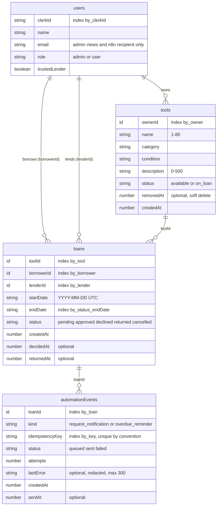
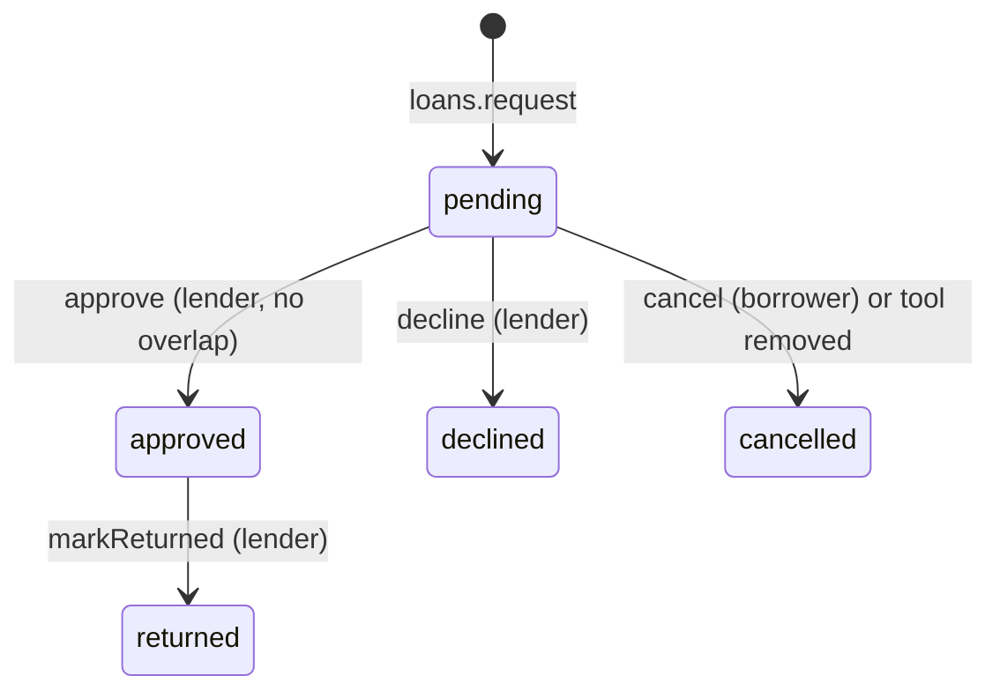
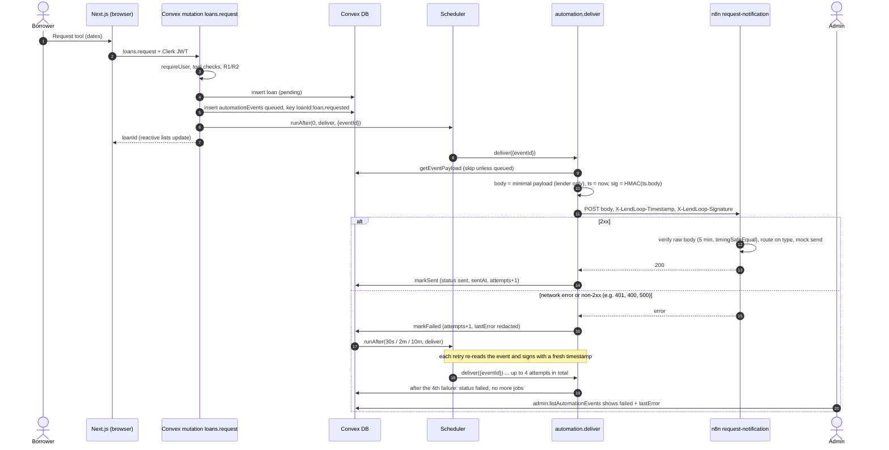
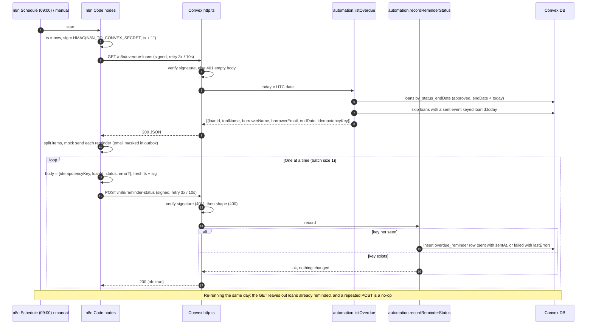

# LendLoop architecture

This is the detailed companion to the README. `SPEC.md` is the source of truth,
`tests/acceptance/CONTRACT.md` defines the API the tests call, and the reasons behind each choice
are in `docs/DECISIONS.md`.

## 1. Components

| Component | Runs where | Responsibility |
|---|---|---|
| Next.js 15 App Router (`app/`, `components/`, `lib/`) | Browser + Node (dev server / host) | Renders pages. Talks to Convex directly over its client, so there are no API routes and no business logic in Next.js. |
| `middleware.ts` | Next.js edge | Redirects signed-out visitors on `/tools`, `/my/*` and `/admin` to `/sign-in?redirect_url=…`. **Convenience only.** |
| Clerk | SaaS | Sign-in and sessions. Issues the `convex` JWT that `ConvexProviderWithClerk` attaches to every Convex call. |
| Convex | Cloud | Data, authorization, business rules, scheduler, outbound delivery and inbound HTTP actions. |
| n8n 2.47.1 (`docker-compose.yml`) | Local Docker, exposed via a tunnel | Sends notifications and overdue reminders (mock outbox) and handles errors. |

### Client wiring

- `app/layout.tsx` (server) holds `ClerkProvider`, with the sign-in and sign-up URLs set in code.
  `components/ConvexClientProvider.tsx` (client) creates a single `ConvexReactClient` and wraps it
  in `ConvexProviderWithClerk`.
- `app/(signed-in)/layout.tsx` wraps every signed-in page in `EnsureUser`. That component waits
  for Convex auth, calls `users.ensure` once per sign-in (guarded by a ref) and only then mounts
  the page. Queries cannot insert the `users` row, so without this gate a brand-new user's first
  query would throw `UNAUTHENTICATED`.
- Every live list is wrapped in `QueryBoundary`, an error boundary that shows the `ConvexError`
  message with a Try again button, because `useQuery` throws server errors during render.
- `/` is public. `PublicTools` uses only `tools.listPublic`. The "Sign in to lend or borrow" link
  is in the server HTML.

## 2. Convex modules

| Module | Responsibility |
|---|---|
| `schema.ts` | Tables, indexes and exported enum validators (category, condition, statuses, role). |
| `lib/auth.ts` | `requireUser` (identity → `users` row; creates the row in mutations only) and `requireAdmin` (adds `role === "admin"`, else `FORBIDDEN`). |
| `lib/errors.ts` | `appError(code, message)` → `ConvexError({ code, message })`. |
| `lib/dates.ts` | Strict `YYYY-MM-DD` parsing, `todayUtc` (overdue), day arithmetic and inclusive range overlap. |
| `lib/zones.ts` | IANA time zone validation and `todayIn(zone)`, shared with the browser. |
| `lib/validation.ts` | Trimming and length checks for tool name (1–80) and description (≤500). |
| `lib/events.ts` | `queueLoanEvent`: idempotent insert of a `queued` event plus `scheduler.runAfter(0, deliver)`. Also builds and parses the key `<loanId>:<type>`. |
| `lib/removal.ts` | `softRemoveTool`, shared by owner removal and admin removal. Sets `removedAt` and cancels pending loans (setting `decidedAt`), queuing one event each. |
| `lib/views.ts` | Per-request lookups for names and badges (never emails), plus `loanAutomation`: up to 10 events newest first, each with `kind`, `status`, times and, for notifications, `type` (e.g. `loan.approved`), and the loan's `emailStatus` (failed > queued > sent > null over all its notifications). No keys or error text. `loanActivity` returns just the events. |
| `tools.ts` | Public tool list, signed-in browse, my listings, create, update and remove. |
| `loans.ts` | Request, cancel, approve, decline, mark returned, my requests and incoming requests. |
| `users.ts` | `ensure`, `me` and the internal `setRole`. |
| `admin.ts` | Admin lists, moderation and resending a failed notification. Every handler starts with `requireAdmin`. |
| `automation.ts` | Internal only: outbound delivery with retries, the overdue list and the reminder write-back. |
| `http.ts` | Signed n8n → Convex routes. |
| `seed.ts` | Internal demo fixtures: `neighbors` (Marcus D., Olivia P., Jake T. and their tools) and `overdueLoan`. |
| `auth.config.ts` | Trusts Clerk JWTs from `CLERK_JWT_ISSUER_DOMAIN` with `applicationID: "convex"`. |

## 3. Function access table

Rows are grouped by gate: public (no auth), `requireUser`, `requireAdmin` and internal (not
callable from clients).

| Function | Kind | Gate | Notes |
|---|---|---|---|
| `tools.listPublic` | query | **public** | Returns exactly `{ _id, name, category }`, available and not removed. |
| `tools.list` | query | requireUser | Non-removed tools with `ownerName`, `ownerTrusted` and `isMine`. No owner id or email. Optional `category` filter. |
| `tools.listMine` | query | requireUser | Own non-removed tools with their pending/approved requests (borrower name and badge). |
| `tools.create` | mutation | requireUser | Owner is the caller. Validated and trimmed. |
| `tools.update` | mutation | requireUser | Owner only (admins too get `FORBIDDEN`). |
| `tools.remove` | mutation | requireUser | Owner only. `CONFLICT` while `on_loan`. Soft delete, which cancels pending loans. |
| `loans.request` | mutation | requireUser | `NOT_FOUND` if the tool is missing or removed, `FORBIDDEN` for your own tool, `INVALID` for bad dates. Queues `loan.requested`. |
| `loans.cancel` | mutation | requireUser | Borrower only, `pending` → `cancelled`. Queues `loan.cancelled`. |
| `loans.approve` | mutation | requireUser | Lender only, `pending` → `approved`. `CONFLICT` on inclusive overlap with an approved loan. Tool becomes `on_loan`. |
| `loans.decline` | mutation | requireUser | Lender only, `pending` → `declined`. |
| `loans.markReturned` | mutation | requireUser | Lender only, `approved` → `returned`. The tool becomes `available` unless another approved loan remains. |
| `loans.listMine` | query | requireUser | My requests, with the lender's name and badge, `activity` (notifications carry `type`) and `emailStatus`. |
| `loans.listIncoming` | query | requireUser | Requests on my tools, with the borrower's name and badge and `activity`. |
| `users.ensure` | mutation | requireUser | Creates or refreshes the caller's row and promotes `ADMIN_EMAILS` (never demotes). |
| `users.me` | query | requireUser | The caller's own row. |
| `admin.listAllLoans` | query | requireAdmin | All loans with names. |
| `admin.listTools` | query | requireAdmin | All tools, **including removed**. |
| `admin.listUsers` | query | requireAdmin | All users, **with emails**. This is the only place they appear. |
| `admin.listAutomationEvents` | query | requireAdmin | Newest first, optional `status`/`kind`/`limit`. Includes `attempts` and `lastError`. |
| `admin.removeListing` | mutation | requireAdmin | Soft delete even while `on_loan`. An approved loan stays returnable. Repeating it is a no-op. |
| `admin.setTrustedLender` | mutation | requireAdmin | Changes `trustedLender` only. |
| `admin.resendEvent` | mutation | requireAdmin | Re-queues a `failed` request notification on the same row and key and schedules `deliver`. `CONFLICT` if it is sent or queued, or out of date (the loan has moved past the transition it announces); `INVALID` for overdue reminders; `NOT_FOUND` for a missing event or loan. One extra attempt, no new retry chain. |
| `users.setRole` | internalMutation | internal | Dashboard/CLI promote or demote. |
| `automation.deliver` | internalAction | internal | Signs and POSTs one event, then records success or failure. |
| `automation.getEventPayload` | internalQuery | internal | Builds the payload. Skips events that are not `queued`. |
| `automation.markSent` / `markFailed` | internalMutation | internal | Record the attempt. `markFailed` schedules the next retry or sets `failed`. |
| `automation.listOverdue` | internalQuery | internal | Approved loans with `endDate < today` not yet reminded today. |
| `automation.recordReminderStatus` | internalMutation | internal | Inserts once per key and returns `{ ok }`. |
| `seed.neighbors` | internalMutation | internal | Demo fixture: Marcus D., Olivia P. and Jake T. with two tools each, linked to their Clerk ids (`scripts/clerk-test-users.mjs`). Never gives two rows the same `clerkId`. |
| `seed.overdueLoan` | internalMutation | internal | Demo fixture: Olivia P.'s stand mixer, due yesterday. |
| `GET /n8n/overdue-loans` | httpAction | HMAC (`N8N_TO_CONVEX_SECRET`) | → `automation.listOverdue`. |
| `POST /n8n/reminder-status` | httpAction | HMAC (`N8N_TO_CONVEX_SECRET`) | → `automation.recordReminderStatus`. |

`requireUser` and `requireAdmin` are the first statement in every gated handler, before any
lookup or validation. The RBAC tests sweep every exported public function to check this. Every
public function declares `args`, and none takes `role` or `isAdmin`.

## 4. Data model

**Loan state machine (R7)**

Any other transition gives `INVALID`, with no write and no event.

**Idempotency keys**

| Kind | Key | Effect |
|---|---|---|
| `request_notification` | `<loanId>:<type>`, where type is `loan.requested`, `loan.approved`, `loan.declined`, `loan.returned` or `loan.cancelled` | R7 lets each transition happen at most once per loan. `queueLoanEvent` skips if the key exists. |
| `overdue_reminder` | `<loanId>:<YYYY-MM-DD>` (UTC) | One reminder record per loan per day. The write-back inserts once, and the overdue list skips loans with a `sent` row for today. |

The two formats cannot collide, because a `YYYY-MM-DD` suffix is never a `loan.*` type, and
`recordReminderStatus` rejects anything other than `<existing loanId>:<valid date>`.

## 5. Sequence: request notification with retries

## 6. Sequence: overdue reminders with write-back

The borrower's `/my/requests` (from `loans.listMine` → `activity`) then shows "Overdue reminder sent to you" in the loan's Activity ledger.

## 7. Failure modes and where they show

| Failure | What happens | Where you see it |
|---|---|---|
| n8n down, tunnel URL changed, or 5xx | `deliver` records the failure and retries at 30 s, 2 min and 10 min. After 4 attempts the event is `failed`. An admin can **Resend** it (`admin.resendEvent`) while it still describes the loan. | Admin → Automated emails (FAILED, "4 of 4", a plain next step such as "n8n couldn't be reached. Check the tunnel address." plus the redacted `lastError`). The borrower sees a FAILED line in the request's Activity, and a red note while that email is still current. |
| `N8N_REQUEST_WEBHOOK_URL` or `CONVEX_TO_N8N_SECRET` unset in Convex | Counted as a failed attempt with normal retries. | Same as above, with `lastError: "Webhook URL or signing secret is not configured"`. |
| Secrets differ between Convex and n8n | n8n answers 401, which Convex treats as a non-2xx failure and retries. | Admin `lastError: "HTTP 401 from webhook"`. The n8n execution log shows the reason. |
| n8n receives an unknown `type` | The Switch fallback answers 400. | Admin `failed` with `HTTP 400`. |
| Recipient or tool missing when delivering | Payload is "broken", counted as a failure and retried. | Admin `lastError: "Recipient or tool missing"`. |
| Duplicate `deliver` job | Skipped, because the event is no longer `queued`. | Nothing to see: at most one send. |
| Forged, unsigned, stale or tampered inbound request | 401, empty body, nothing written. | Caller only. Convex logs show the 401. |
| `N8N_TO_CONVEX_SECRET` unset in Convex | Every inbound request gets 401. | n8n HTTP node fails after 3 tries, and the error handler alerts. |
| `CONVEX_TO_N8N_SECRET` unset in n8n | The Verify node throws (not 401). | n8n error handler (mock outbox / Slack / Discord). Convex retries, then shows `failed`. |
| Convex unreachable from n8n | HTTP nodes retry 3 times, 10 s apart, then the run stops. | n8n error handler. The next run is safe because write-backs are idempotent. |
| Mock send fails for one reminder | Written back as `status: "failed"` with a short error. The loop continues. | Admin → Automated emails (Overdue reminder, FAILED, `lastError`; no Resend, the next daily run retries). Borrower Activity shows "Overdue reminder didn't go through". |
| Malformed write-back (bad JSON, unknown loan, wrong key format) | 400, nothing written. | n8n execution, and the error handler if retries run out. |
| A signed-in user without a `users` row runs a query | `UNAUTHENTICATED`. `EnsureUser` prevents this in the UI. | The `EnsureUser` error state with Retry. |
| A plain user opens `/admin` | The UI shows "Admins only". Any admin query would get `FORBIDDEN`. | Admin page. |

## 8. Known limits (deliberate at this scale)

- Lists collect whole tables, newest first. Pagination and extra indexes are production work.
- n8n does not deduplicate by `eventId`. A Convex retry after n8n sent but the response was lost
  could therefore notify twice. A nonce or `eventId` store is listed under production changes in
  the README.
- After a failed reminder, a re-run on the same day tries that loan again. That is deliberate. A
  successful retry upgrades today's row from `failed` to `sent` once, and later runs skip the loan.
- `ADMIN_EMAILS` promotion trusts the identity email unless the token says it is unverified. The
  Clerk instance should require verified primary emails.
- "Today" for the date rules (R2, approve before the start) is the day in the acting user's own
  time zone (`users.timeZone`, UTC if unset). The daily overdue check and its reminder key stay on
  UTC. The n8n container timezone (`GENERIC_TIMEZONE`) only decides when 09:00 fires.
